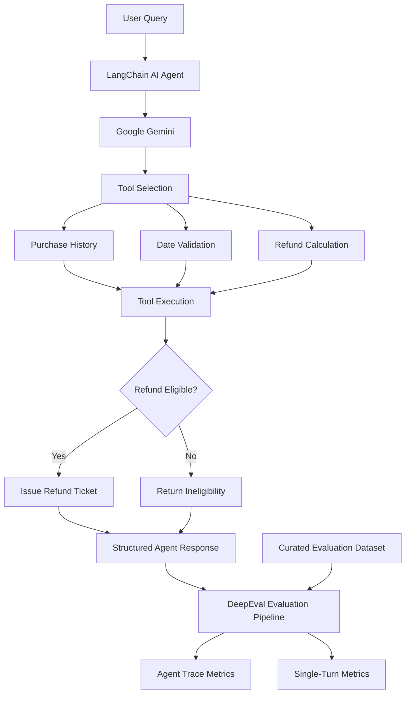
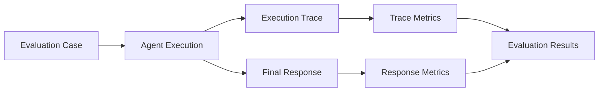

# AI Agent Evaluation System

An evaluation framework for **tool-using AI agents**, built with LangChain, Google Gemini, and DeepEval. It evaluates agent behavior beyond final responses, measuring tool selection, argument correctness, execution efficiency, plan adherence, task completion, and answer quality.

<p align="center">
  
  
  
  
</p>

<p align="center">
  
  
  
  
  
</p>

---

## Table of Contents

- [Overview](#overview)
- [Key Features](#key-features)
- [Architecture](#architecture)
- [Technology Stack](#technology-stack)
- [Project Structure](#project-structure)
- [Getting Started](#getting-started)
- [Running Evaluations](#running-evaluations)
- [Evaluation Dataset](#evaluation-dataset)
- [Evaluation Metrics](#evaluation-metrics)
- [Configuration](#configuration)
- [Evaluation Reliability](#evaluation-reliability)
- [Limitations](#limitations)
- [Security Considerations](#security-considerations)
- [Roadmap](#roadmap)
- [License](#license)

---

## Overview

Traditional LLM evaluation often focuses on the quality of a model's final response. However, an AI agent can produce a seemingly correct answer while using the wrong tools, passing incorrect arguments, taking unnecessary actions, or failing to complete the intended task.

This project explores a more comprehensive approach to agent evaluation by examining both **what an agent produces and how it gets there**.

It implements a tool-using customer support agent powered by Google Gemini and evaluates its execution using DeepEval.

The example agent handles customer support workflows involving:

- Retrieving customer purchase history.
- Checking refund eligibility.
- Calculating refund amounts.
- Issuing refund tickets.
- Responding to customer queries using structured outputs.

The evaluation pipeline uses curated scenarios and multiple metrics to assess agent execution traces and individual interactions.

## Key Features

- **Tool-Calling AI Agent:** Build a customer support agent using LangChain and Google Gemini.
- **Execution Trace Evaluation:** Assess the agent's intermediate execution steps, not just its final response.
- **Tool Selection Evaluation:** Verify whether the agent chooses the appropriate tools for a given request.
- **Argument Validation:** Evaluate the correctness of arguments passed to individual tools.
- **Planning and Efficiency:** Measure execution strategy, plan adherence, and unnecessary steps.
- **Response Evaluation:** Assess final answers against expected outputs using LLM-as-a-Judge.
- **Structured Outputs:** Use Pydantic models for typed responses and validated tool inputs.
- **Curated Evaluation Dataset:** Test the agent against seven customer support scenarios.
- **Modular Evaluation Pipeline:** Run combined or individual metric experiments.

## Architecture

### System Architecture

The system consists of four primary components: the agent, its tools, the evaluation dataset, and the evaluation pipeline.



### Evaluation Workflow



The evaluation process examines both the agent's execution behavior and its final response.

### Core Components

| Component | Responsibility |
|---|---|
| Agent | Interprets user requests and orchestrates tool calls |
| Gemini | Provides LLM reasoning and response generation |
| Tools | Execute purchase, date, refund, and ticket operations |
| Pydantic | Defines structured outputs and tool-input models |
| Evaluation Dataset | Provides scenarios, expected outputs, and expected tool calls |
| DeepEval | Evaluates execution traces and individual interactions |

## Technology Stack

| Technology | Purpose |
|---|---|
| Python 3.13+ | Core development |
| LangChain | Agent construction and tool orchestration |
| Google Gemini | Agent reasoning and evaluation judge |
| DeepEval | Agent and response evaluation |
| Pydantic | Structured outputs and data validation |
| uv | Dependency and environment management |

## Project Structure

```text
AI-Agent-Evaluation-System/
│
├── agent/
│   ├── agent.py                      # Agent construction and conversation helper
│   ├── data.py                       # In-memory sample purchase data
│   ├── models.py                     # Gemini model configuration
│   ├── objects.py                    # Pydantic response and tool-input models
│   ├── prompts.py                    # Agent instructions
│   └── tools.py                      # Purchase, refund, ticket and date tools
│
├── evals/
│   ├── eval_pipeline.py              # Combined DeepEval evaluation runner
│   ├── model.py                      # DeepEval judge model configuration
│   └── tests.py                      # Evaluation cases and DeepEval goldens
│
├── individual_evaluation_metrics/
│   └── ...                           # Standalone metric experiments
│
├── main.py                           # Default project scaffold
├── pyproject.toml                    # Project metadata and dependencies
├── uv.lock                           # Locked dependency versions
├── .env.example                      # Environment variable template
└── README.md
```

## Getting Started

### Prerequisites

Ensure the following are installed:

- Python **3.13 or later**
- [uv](https://docs.astral.sh/uv/) package manager
- Google Gemini API key

### 1. Clone the Repository

```bash
git clone <your-repository-url>
cd <repository-name>
```

### 2. Install Dependencies

Install the dependencies using the committed lockfile:

```bash
uv sync --locked
```

This creates or updates the project environment using the versions specified in `uv.lock`.

### 3. Configure Environment Variables

Create a local environment file from the provided template:

**Windows PowerShell**

```powershell
Copy-Item .env.example .env
```

**macOS / Linux**

```bash
cp .env.example .env
```

Add your API credentials:

```dotenv
GOOGLE_API_KEY=your-google-api-key
```

The DeepEval judge configuration also accepts:

```dotenv
GEMINI_API_KEY=your-google-api-key
```

Use the appropriate credential for each configured component.

> **Security:** Never commit `.env` files, API keys, or other sensitive credentials. Keep `.env.example` limited to placeholder values.

## Running Evaluations

### Combined Evaluation Pipeline

Execute the complete evaluation pipeline from the repository root:

```bash
uv run python -m evals.eval_pipeline
```

The pipeline executes the configured DeepEval metrics against the evaluation dataset and prints the evaluation results in the terminal.

### Syntax Validation

Check Python syntax across the project without making LLM API calls:

```bash
uv run python -m compileall -q agent evals individual_evaluation_metrics main.py
```

### API Usage and Costs

Evaluation involves calls to the configured Gemini models.

Depending on the number of test cases, evaluation metrics, and model configuration, execution may incur API usage charges.

Consider running a small evaluation subset during development before executing the complete pipeline.

## Evaluation Dataset

The current evaluation dataset contains **7 curated customer support scenarios** designed to test different agent behaviors.

Each `EvaluationCase` contains:

- A unique scenario identifier.
- Tags for categorizing and filtering scenarios.
- A DeepEval `Golden` containing the input, expected output, and expected tool calls.
- Expected ticket issuance status.
- Expected refund amount.
- Expected refunded items.

### Test Scenarios

| Scenario | Expected Behavior |
|---|---|
| Two eligible items | Issue a combined refund |
| Single eligible item | Issue the corresponding refund |
| Purchase history request | Retrieve purchase history without issuing a refund |
| Invalid username | Reject the request and ask for valid credentials |
| Purchase outside 30 days | Reject the refund |
| Mixed eligibility | Refund eligible items only |
| Item not purchased | Reject the refund request |

### Adding New Evaluation Cases

New scenarios can be added to the `cases` list in:

```text
evals/tests.py
```

When extending the dataset:

1. Define the input and expected behavior.
2. Specify expected tool calls and arguments.
3. Add the corresponding expected refund and ticket metadata.
4. Ensure the evaluation dataset and case-to-golden ordering remain aligned.
5. Run the evaluation pipeline to inspect the results.

**Date-dependent scenarios:** The current date tool uses Python's `date.today()`. Refund eligibility can therefore change over time. Introducing a controllable clock would improve test reproducibility.

## Evaluation Metrics

The combined evaluation pipeline uses seven metrics across two evaluation categories.

### 1. Agent Trace Metrics

These metrics assess the agent's overall execution process.

| Metric | Evaluation Objective |
|---|---|
| Task Completion | Determines whether the agent successfully completes the requested task |
| Step Efficiency | Evaluates whether the agent avoids unnecessary execution steps |
| Plan Quality | Assesses the quality and logical structure of the execution strategy |
| Plan Adherence | Measures whether the agent follows its intended execution plan |

### 2. Single-Turn Metrics

These metrics evaluate individual agent interactions.

| Metric | Evaluation Objective |
|---|---|
| Argument Correctness | Determines whether tools receive the expected arguments |
| Tool Correctness | Evaluates whether the agent selects the appropriate tools |
| Answer Correctness | Compares the final response with the expected answer using GEval |

### Understanding Evaluation Results

The metrics provide complementary perspectives:

- **Task completion** focuses on whether the intended outcome was achieved.
- **Step efficiency** focuses on unnecessary or redundant execution.
- **Plan quality and adherence** examine the agent's execution strategy.
- **Tool and argument correctness** examine tool usage.
- **Answer correctness** examines the quality of the final response.

Configured metric thresholds are experimental starting points, not calibrated production acceptance criteria.

LLM-based evaluation is useful for assessing semantic correctness. However, critical business outcomes should also be verified through deterministic assertions.

For example, refund eligibility, calculated amounts, refunded items, and ticket issuance should be independently checked rather than relying exclusively on an LLM judge.

## Configuration

### Agent Model

The agent's Gemini configuration is maintained in:

```text
agent/models.py
```

### Evaluation Judge

The DeepEval judge configuration is maintained in:

```text
evals/model.py
```

The current configuration uses `gemini-3.5-flash-lite` for both the agent and evaluation judge.

Review model availability and update the configuration when necessary.

When changing model providers, credentials, or model versions, verify both configurations independently.

## Evaluation Reliability

Reliable agent evaluation requires more than a single aggregate score.

The following practices are important when extending this project:

| Practice | Benefit |
|---|---|
| Deterministic assertions | Verify critical business outcomes independently |
| Fixed test clock | Prevent date-dependent evaluation drift |
| Independent judge model | Reduce shared-model evaluation bias |
| Expanded evaluation cases | Improve scenario coverage |
| Versioned evaluation datasets | Track changes in test coverage |
| Regression testing | Identify performance degradation between agent versions |
| Execution trace inspection | Diagnose incorrect tool calls and execution paths |

### Recommended Evaluation Strategy

A robust evaluation workflow should combine:

1. **Deterministic validation:** Verify exact outputs, tool arguments, refund calculations, and state changes.
2. **Trace evaluation:** Assess execution quality, planning, and tool selection.
3. **Semantic evaluation:** Use an LLM judge to evaluate response quality.
4. **Regression evaluation:** Compare results across different agent and prompt versions.

This hybrid approach helps reduce the risk of treating an apparently good final answer as evidence of correct agent execution.

## Current Limitations

This repository is an experimental prototype rather than a production-ready customer support system.

| Area | Current Limitation |
|---|---|
| Refund policy | Eligibility rules are primarily defined in the agent prompt rather than enforced deterministically |
| Ticket issuance | The ticket tool simulates successful issuance; no real ticket or refund is created |
| Data persistence | Purchase records are stored in a hard-coded in-memory dataset |
| Time handling | The date tool uses the live system date, making some tests time-dependent |
| Outcome validation | Expected refund amounts and refunded items are metadata rather than deterministic assertions against observed tool effects |
| Evaluation independence | The agent and judge use the same Gemini model configuration |
| Automated testing | No CI workflow or dedicated automated test suite is currently configured |
| Entry point | `main.py` remains the default project scaffold; the evaluation pipeline is the primary execution entry point |

These limitations are important considerations before extending the prototype into a real-world agent application.

## Security Considerations

Tool-using agents introduce risks beyond conventional LLM applications because model outputs can trigger application actions.

Before connecting this system to real customer data or financial operations:

- Keep API credentials in environment variables or a dedicated secrets manager.
- Treat user prompts, tool arguments, and model-generated outputs as untrusted input.
- Validate tool arguments using explicit schemas and backend checks.
- Enforce refund policies in deterministic application logic rather than relying on prompt instructions.
- Require authorization before executing sensitive operations.
- Implement audit logging for tool executions and state-changing operations.
- Apply least-privilege access to external services.
- Never connect the current simulated refund workflow directly to a real payment or refund system.

## Roadmap

Potential improvements for evolving this project:

- [ ] Move refund eligibility and business rules into deterministic backend services.
- [ ] Add deterministic assertions for refund amounts, refunded items, and ticket status.
- [ ] Introduce a controllable clock for reproducible evaluations.
- [ ] Evaluate agents using independent judge models.
- [ ] Expand the dataset with adversarial and edge-case scenarios.
- [ ] Add automated unit and integration tests.
- [ ] Integrate evaluation into a CI/CD pipeline.
- [ ] Generate structured evaluation reports and regression comparisons.
- [ ] Track evaluation results across agent, prompt, and model versions.

## License

No license file is currently included in the repository. All rights and usage permissions are reserved by default unless a license is added.

---

<p align="center">
  <sub>Exploring reliable AI agents through execution tracing, tool evaluation, and LLM-based testing.</sub>
</p>